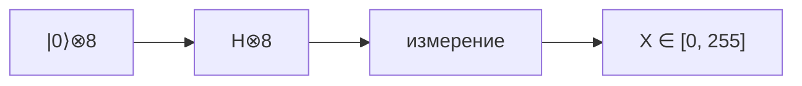
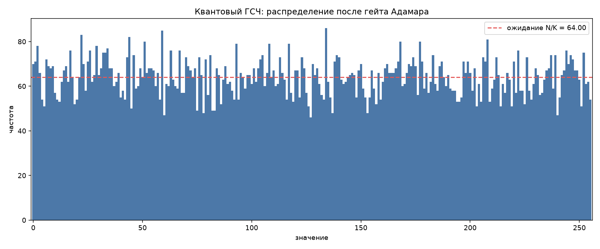

# Квантовый генератор случайных чисел на гейте Адамара

Диапазон: закрытый интервал **[0, 255]**. Симуляция: Qiskit Aer, `seed = 42`.

Запуск:

```bash
cd quantum
uv venv .venv --python 3.12
uv pip install --python .venv -r requirements.txt
.venv\Scripts\python.exe main.py
```

---

## 1. Постановка задачи

Реализовать генератор целых случайных чисел **X** на квантовой схеме, такой что

```
X ∈ {0, 1, …, 255}
```

источником случайности служит **гейт Адамара**, а не классический PRNG.

Почему 8 кубитов:

- мощность диапазона: 256 значений;
- 2<sup>8</sup> = 256, поэтому восьми кубитов достаточно и отбраковка не нужна;
- измерение даёт байт напрямую: каждый исход имеет вероятность 1 / 256.

Критерии качества: покрытие всего диапазона, близость среднего и дисперсии к теоретическим, энтропия Шеннона, χ<sup>2</sup>-критерий равномерности.

---

## 2. Описание алгоритма

Гейт Адамара действует на базисное состояние так:

```
H|0⟩ = (|0⟩ + |1⟩) / √2

         ⎛ 1   1 ⎞
H = 1/√2 ⎜       ⎟
         ⎝ 1  −1 ⎠
```

Для n независимых кубитов, стартующих из |0⟩<sup>⊗n</sup>:

**|ψ⟩ = H<sup>⊗n</sup> |0⟩<sup>⊗n</sup> = 2<sup>−n/2</sup> Σ |k⟩**, где k = 0, …, 2<sup>n</sup> − 1.

Измерение в вычислительном базисе даёт целое k с вероятностью 1 / 2<sup>n</sup>.

Для [0, 255] берётся n = log<sub>2</sub> 256 = 8. Каждый исход — равномерный байт:

```
X = k ∈ {0, 1, …, 255},    P(X = k) = 1 / 256
```



ООП-структура проекта:

| Класс | Роль |
|---|---|
| `QuantumRngConfig` | границы диапазона, shots, seed, число кубитов |
| `HadamardCircuitBuilder` | схема H<sup>⊗n</sup> + измерение |
| `AerCircuitExecutor` | транспиляция и запуск на `AerSimulator` |
| `MeasurementDecoder` | битовая строка → целое k |
| `RangeRejectionFilter` | проверка попадания в [0, 255] |
| `DistributionAnalyzer` | моменты, энтропия, χ<sup>2</sup> |
| `QuantumRandomNumberGenerator` | фасад всего конвейера |

---

## 3. Код (Qiskit)

Ядро схемы — класс `HadamardCircuitBuilder` (`qrng/circuit.py`):

```python
from qiskit import QuantumCircuit, transpile
from qiskit_aer import AerSimulator


class HadamardCircuitBuilder:
    def __init__(self, qubit_count: int) -> None:
        self._qubit_count = qubit_count

    def build(self) -> QuantumCircuit:
        circuit = QuantumCircuit(self._qubit_count, self._qubit_count, name="hadamard_qrng")
        circuit.h(range(self._qubit_count))
        circuit.barrier()
        circuit.measure(range(self._qubit_count), range(self._qubit_count))
        return circuit


builder = HadamardCircuitBuilder(qubit_count=8)
circuit = builder.build()

simulator = AerSimulator(seed_simulator=42)
compiled = transpile(circuit, simulator)
counts = simulator.run(compiled, shots=16384).result().get_counts()
```

Чертёж схемы (Qiskit, 8 кубитов):

```
     ┌───┐ ░ ┌─┐
q_0: ┤ H ├─░─┤M├─────────────────────
     ├───┤ ░ └╥┘┌─┐
q_1: ┤ H ├─░──╫─┤M├──────────────────
     ├───┤ ░  ║ └╥┘┌─┐
q_2: ┤ H ├─░──╫──╫─┤M├───────────────
     ├───┤ ░  ║  ║ └╥┘┌─┐
q_3: ┤ H ├─░──╫──╫──╫─┤M├────────────
     ├───┤ ░  ║  ║  ║ └╥┘┌─┐
q_4: ┤ H ├─░──╫──╫──╫──╫─┤M├─────────
     ├───┤ ░  ║  ║  ║  ║ └╥┘┌─┐
q_5: ┤ H ├─░──╫──╫──╫──╫──╫─┤M├──────
     ├───┤ ░  ║  ║  ║  ║  ║ └╥┘┌─┐
q_6: ┤ H ├─░──╫──╫──╫──╫──╫──╫─┤M├───
     ├───┤ ░  ║  ║  ║  ║  ║  ║ └╥┘┌─┐
q_7: ┤ H ├─░──╫──╫──╫──╫──╫──╫──╫─┤M├
     └───┘ ░  ║  ║  ║  ║  ║  ║  ║ └╥┘
c: 8/═════════╩══╩══╩══╩══╩══╩══╩══╩═
              0  1  2  3  4  5  6  7
```

Полный конвейер: `qrng/generator.py`, точка входа — `main.py`.

---

## 4. Результаты

Симулятор: `AerSimulator`, N<sub>shots</sub> = 16384, seed = 42.

Получено **16384** числа. В выборке встретились **все 256** значений диапазона, включая границы 0 и 255.

Примеры сгенерированных чисел:

`55, 12, 139, 123, 112, 69, 51, 43, 215, 16, 15, 46, 110, 117, 13, 100, 214, 111, 230, 141, 2, 80, 215, 173, 141, 77, 108, 171, 51, 46, 193, 48`

| Показатель | Эксперимент | Теория (равномерное на [0, 255]) |
|---|---:|---:|
| Число кубитов | 8 | log<sub>2</sub> 256 = 8 |
| Размер выборки | 16384 | 16384 |
| Уникальных значений | 256 | 256 |
| Минимум / максимум | 0 / 255 | 0 / 255 |
| Среднее | 126.707 | 127.500 |
| СКО | 74.132 | 73.900 |
| Энтропия Шеннона, бит | 7.988 | 8.000 |
| χ<sup>2</sup> (df = 255) | 261.03 | E[χ<sup>2</sup>] = 255 |
| p-value χ<sup>2</sup> | 0.384 | не отвергать H<sub>0</sub> при α = 0.05 |

Критическое значение χ<sup>2</sup><sub>0.05, 255</sub> ≈ 293.2. Наблюдаемая статистика 261.03 меньше порога, гипотеза равномерности **не отвергается**.

Гистограмма частот (красная линия — ожидание N / K = 64):



Колебания вокруг линии ожидания типичны для конечной выборки: при идеально равномерном источнике дисперсия частоты каждого значения равна Np(1 − p) ≈ 63.75.

Сводка эксперимента: `results/summary.json`.

---

## 5. Вывод

Гейт Адамара на 8 кубитах даёт равномерную суперпозицию 256 базисных состояний. Измерение сразу даёт равномерный байт в **закрытом интервале [0, 255]**.

По выборке из 16384 чисел:

- среднее и СКО совпадают с теорией с относительной погрешностью менее 1 %;
- энтропия составляет 99,9 % от максимума 8 бит;
- χ<sup>2</sup>-критерий не отвергает равномерность (p = 0.384).

Схема подтверждает, что QRNG на H<sup>⊗n</sup> — прямой способ получить равномерные биты из квантовой суперпозиции, когда длина диапазона равна степени двойки.
