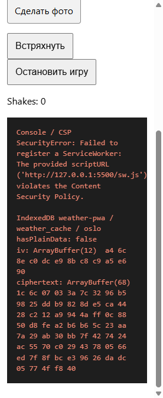
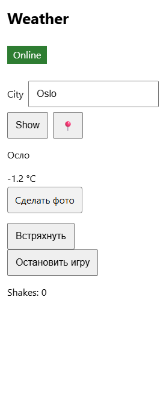

# Application: что есть и чего нет

Проверка в браузере: http://127.0.0.1:5500/ → F12 → Application.  
После первой проверки в хранилище добавлены случайные учебные записи, страница обновлена, проверка повторена.

CSP задан через `<meta>` в `index.html` (учебный компромисс: нет сервера, поэтому нет HTTP-заголовка). В продакшене CSP должен быть заголовком ответа. В `<meta>` нет `report-to`, `frame-ancestors` и nonce.

---

## 1. Local Storage

### Есть
После reload сохранились три ключа origin `http://127.0.0.1:5500`:

| Ключ | Значение | Зачем |
|---|---|---|
| `weather-pwa:last-geo` | `{"latitude":59.1,"longitude":15.9,"name":"Randomville","temperature":13.6}` | fallback геолокации (шаг 2). До ручной записи ключа не было: он пишется только после 📍 |
| `weather-pwa:demo-seed` | `rnd-98z8g0mi` | учебная случайная строка |
| `weather-pwa:demo-note` | `audit-sample-1795574513992` | учебная метка аудита |

Координаты в `last-geo` лежат открытым JSON. XSS может их прочитать.

До добавления случайных данных Local Storage был **пустой**.

### Нет
- токенов
- паролей
- cookie-сессий
- ключей API

---

## 2. IndexedDB

База: `weather-pwa` (version 3).

### Есть

**Store `weather_cache`** — прогноз **зашифрован AES-GCM** ключом `session_key` (Шаг 4). В DevTools нет JSON `data`, только бинарный мусор:

| Ключ | В DevTools | timestamp |
|---|---|---|
| `cairo` | `iv: ArrayBuffer(12)`, `ciphertext: ArrayBuffer(66)` | без открытой температуры |
| `tokyo` | `iv` + `ciphertext: ArrayBuffer(66)` | то же |
| `london` | `iv` + `ciphertext: ArrayBuffer(88)` | то же |
| `oslo` | `iv` + `ciphertext: ArrayBuffer(68)` | живой ответ MET, тоже ciphertext |

Приложение расшифровывает в рантайме и показывает «Осло, −1.2 °C». `hasPlainData: false`.

**Store `photos`**

| Ключ | Значение |
|---|---|
| `photo-1795574513992` | JPEG dataURL (~243 символа) + timestamp |

До «Отправить» / учебной записи store `photos` не существовал.

**Store `local-forage-detect-blob-support`**  
Служебный store localForage, записей нет.

### Нет
- токенов и паролей
- других баз IndexedDB
- сторонних store (корзина, auth, платежи)

XSS может вызвать `decrypt` и прочитать прогноз, а также dataURL фото. Токенов в этом store нет.

---

## 3. Service Worker и граница `worker-src`

### Есть
Свой `sw.js`, регистрация в `js/navigator-sw.js`. При `worker-src 'self'` в Application виден только `http://127.0.0.1:5500/sw.js`.

### Проверка директивы
Временно ставили `worker-src 'none'`. Регистрация падает:

`SecurityError: Failed to register a ServiceWorker: The provided scriptURL ('http://127.0.0.1:5500/sw.js') violates the Content Security Policy.`

`securitypolicyviolation`: `effectiveDirective: worker-src`, `disposition: enforce`. Приложение при этом живое (Oslo на экране). Директиву вернули в `'self'` — SW снова регистрируется.

### Нет
- постороннего worker

---

## 4. Cache Storage

### Есть
Ничего: список кэшей пустой.

### Нет
- кэша своих HTML/CSS/JS
- сторонних скриптов в Cache Storage

localforage грузится с `https://cdn.jsdelivr.net` в рантайме и в Cache Storage не кладётся.

---

## 5. Session Storage / Cookies

### Есть
Ничего в нашем PWA: нет логина, нет `Set-Cookie`.

### Нет
- sessionStorage-ключей
- cookie приложения
- токенов в `localStorage` / IndexedDB (и не надо их туда класть)

---

## 6. Почему токен — только HttpOnly cookie

XSS на странице читает `localStorage`, IndexedDB и `document.cookie`.  
**HttpOnly cookie в `document.cookie` не попадает.** Скрипт не унесёт токен на своё устройство. Он может лишь слать запросы от имени пользователя — это CSRF, его закрывают **SameSite**.

`Set-Cookie` нельзя эмулировать из JavaScript или Service Worker: это [forbidden response header](https://developer.mozilla.org/en-US/docs/Glossary/Forbidden_response_header_name), браузер выкинет его из любого самодельного ответа.

### Практическая проверка (google.com)

В соседней вкладке открыт https://www.google.com/.

`document.cookie` вернул только то, что **не** HttpOnly:

- `__Secure-STRP=…`
- `SEARCH_SAMESITE=…`

HttpOnly-cookie (в Application → Cookies с галочкой HttpOnly, типично `NID` / `AEC` / сессионные `SID`) в этой строке **нет**. JS их не видит, DevTools — видит.

### Что ставить на токен

`HttpOnly` + `Secure` + `SameSite=Lax` (или `Strict`).

Для жёсткой привязки к домену — имя `__Host-session`: обязательно `Secure`, `Path=/`, **без** `Domain`, иначе поддомен мог бы перезаписать cookie.

---

## 7. Вывод: IndexedDB + AES ≠ HttpOnly cookie

Шифрование кэша погоды в IndexedDB не заменяет HttpOnly cookie для токена: XSS выполняется в том же origin и просто вызывает `crypto.subtle.decrypt` с уже загруженным `session_key`. HttpOnly cookie JavaScript не читает, поэтому унести сессию на чужое устройство таким скриптом нельзя.
